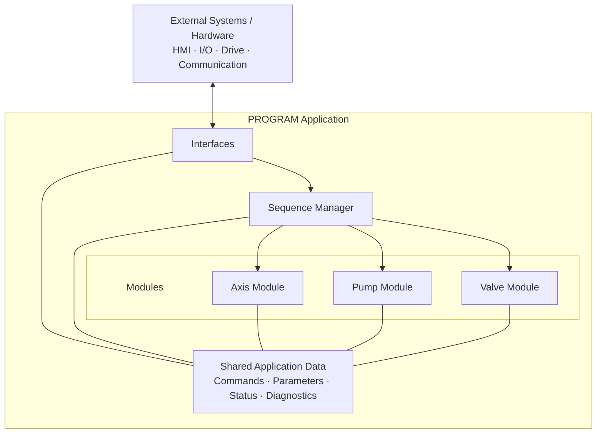

# Application Architecture

This diagram shows the application composition and the execution relationship between the main software components.



`Application` acts as the composition root. It owns the shared application data, instantiates the main components, and defines their execution order.

The primary execution flow is:

```text
Read Interfaces
        ↓
Sequence Manager
        ↓
Axis / Pump / Valve Modules
        ↓
Write Interfaces
```

Commands, parameters, status, and diagnostics are shared application data used to exchange information between these components. They are not separate executable components.
