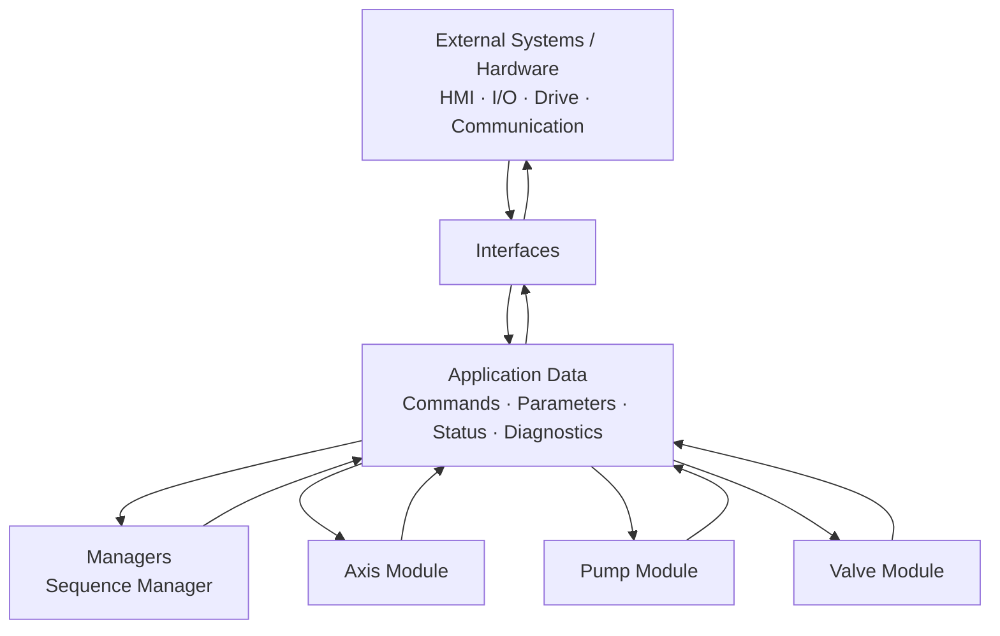

# Application Architecture

This diagram shows the logical structure of the application and the primary direction of data flow between its components.

The diagram represents logical responsibilities and data flow rather than direct component-to-component calls.

Managers make application-level decisions, modules execute subsystem behaviour, and interfaces isolate the application from external systems and hardware.
