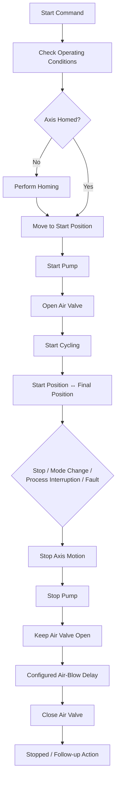

# Automatic Operation

This diagram summarizes the normal automatic production sequence and the controlled stop path.

The normal production path starts only after the required operating conditions are satisfied and the axis has a valid homing reference.

The final action after a controlled stop depends on the condition that initiated the stop.
