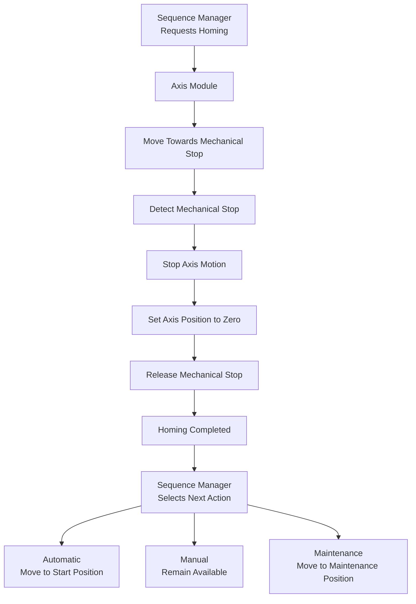

# Homing Responsibility

This diagram shows the separation of responsibility between the Sequence Manager and the Axis Module during homing.

The Axis Module owns the homing procedure itself.

The Sequence Manager owns the machine-level decision that follows successful homing.
